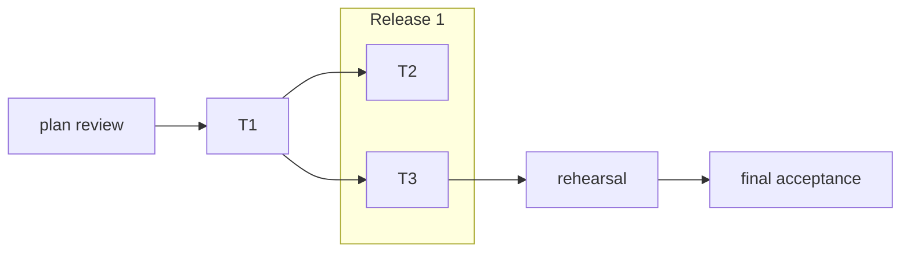

# The plan, in two levels

A delegate reads `core.md`, its own task file and the `contracts.md` sections its task
names. Nothing else of the plan. Write the plan so that is enough. With superpowers, write it
with superpowers:writing-plans in this layout.

~~~text
<plan-dir>/
  criteria.md     C1..Cn, each checkable by a command or test
  core.md         goal, constraints, review focus, graph          (< 10 KB)
  contracts.md    every shared interface, as it is now
  tasks/T1-<slug>.md ...                                          (< 8 KB each)
~~~

## core.md

~~~markdown
# <change>

Goal: <one paragraph>. Criteria: criteria.md. Spec: <path, if any>.
Gate: fast `<build and compile tests>`; full `<everything, with the expensive variants>`.

## Constraints
<numbered, one line each: architecture rules, comment rule, commit format, no personal
data in fixtures, what never to touch>

## Review focus
<the failures a reviewer must try against real systems, as scenarios:>
- RF1 nested repository: WHEN a workspace holds a nested repo with uncommitted work THEN removal refuses it.
- RF2 sweep cost: WHEN 80 worktrees exist THEN one sweep takes under 1 s.

## Graph
<the first mermaid flowchart of the file, as below>
~~~

Graph nodes with a task file are tasks; the others are gates (plan review, rehearsal,
reviews, acceptance). Subgraphs are releases. An edge means the consumer needs the
producer's **behavior**, not its types: a consumer that only needs an interface codes
against `contracts.md` and has no edge. A task that produces a contract commits the types
alone first, so a consumer can branch from that commit before the producer merges.

## tasks/T7-slug.md

~~~markdown
# T7 Workspace removal through the engine

Contracts: consumes `contracts.md#workspace`, `#engine-step`; produces `#cleanup-config` (below).
Files: internal/core/workspaces/, internal/cli/remove.go, tests beside them.
Overlaps: T10 in internal/cli/serve.go (T7 owns `registerCleanup`, T10 the rest).
Model: most capable.

## Requirements

### R1 Removal refuses unsafe workspaces
The engine SHALL refuse to remove a workspace with work not on a remote.
- WHEN the worktree has uncommitted changes THEN the step refuses with `has local work`. Test: `TestRemoveRefusesDirtyWorktree`.
- WHEN a nested repository has commits not pushed THEN the step refuses. Test: `TestRemoveRefusesNestedRepoWithWork`.

## Produces

### cleanup-config
    type Cleanup struct { Disposable []string `json:"disposable"` }

## Steps
1. Write the R1 tests, see them fail. 2. ... (only what is not obvious from the requirements)
~~~

- **Requirements** follow OpenSpec: one `SHALL` per requirement, each with WHEN/THEN
  scenarios (GIVEN when the setup is not obvious). Every scenario names its test, so the
  reviewer checks coverage by name and the implementer writes the tests first.
- **Overlaps** is the real file overlap with other tasks, and who owns which part. Empty
  means the task can start whenever its contracts are written. Never write "runs alone":
  name the files.
- **Model**: the most capable model for every task that changes code; the cheap tier only
  for a docs-only task.
- **Lite** for a mechanical task: Files, one requirement, the test command. Full for a task
  that produces a contract, replaces behavior or touches data.
- A task that **replaces behavior** has a scenario for the differential test against the old
  code path.
- A task that **builds fixtures from real data** says where the reducer runs (the run
  directory, never committed beside the fixtures) and what personal data it strips (names,
  logins, emails, hosts).

## contracts.md: current state, folded at each merge

`contracts.md` holds every interface two tasks share (types, signatures, wire formats, file
formats, CLI output), one `##` heading per contract, in its **current** form. It is never a
log. A task that changes or adds a contract reports a delta in OpenSpec's shape:

~~~markdown
## Contract deltas
### MODIFIED workflow-enums
<the full new text of the section>
### ADDED cleanup-config
<full text>
### REMOVED legacy-scratch-dir
<why, and what replaces it>
### RENAMED engine-step -> step
~~~

Only the task whose Files hold a contract changes it. A consumer that needs a change
reports it as a concern; the orchestrator rules and routes it to the owner. A renamed or
changed member of a section is a MODIFIED of that section.

At merge the orchestrator folds the deltas into `contracts.md` in the merge commit: ADDED
appended, MODIFIED replaces the section, REMOVED deleted, RENAMED retitled. A delta that
breaks a task not merged yet goes to that task's file in the same commit, to the task by SendMessage when it is in
flight, and the ledger line names it. An exported name another task may use is never removed or renamed without a
declared delta.

## Plan review

First act of the run, before delegating, on the most capable model:

~~~text
Harden this plan before parallel subagents execute it unattended. Read-only in <worktree>.
Read <plan-dir>/ (criteria, core, contracts, every task file), the handoff, and the code.
Find: names and signatures that differ from the code; scenarios whose test cannot fail;
requirements of the criteria no task delivers; files a criterion needs that no task owns; overlaps not declared; graph edges that are
only type dependencies; contracts a consumer cannot code against; steps that break a
constraint or a safety rule. Write findings to <run-dir>/plan-review.md as Critical /
Important / Minor, each with the plan file, the code location and the fix. Reply with the
counts and the path.
~~~

Apply what holds up in one commit; log a ruling for each finding rejected.

## Phases

A phase boundary exists only where an irreversible consequence must be verified before going
on (a migration of the user's data, an install into the user's homes, the first remote
write). The plan names the check that clears it; an agent runs it.
