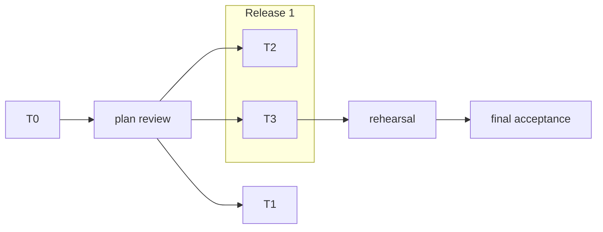

# The plan: short prose, contracts in code

Prose carries what code cannot: goal, constraints, failures to attack, graph. Everything
two tasks share is compiling code from a skeleton task run before the fan-out. A delegate
reads `core.md`, its task file and the API docs of what it consumes. Language idioms:
`references/<language>.md` (Go: `references/go.md`).

The plan lives in the run directory (`<plan-dir>` = `<run-dir>/plan`), never in the
repository.

~~~text
<plan-dir>/
  criteria.md     C1..Cn, each checkable by a command or test
  core.md         goal, constraints, review focus, graph          (< 6 KB)
  tasks/T1-<slug>.md ...                                          (< 2 KB each)
~~~

## core.md

~~~markdown
# <change>

Goal: <one paragraph>. Criteria: criteria.md. Spec: <path, if any>.
Checks: lane `<build, lint, tests of the touched packages and their importers>`;
integration `<everything, with the expensive variants>`, at most <2> at once.

## Constraints
<numbered, one line each: architecture rules, comment rule, commit format, no personal
data in fixtures, what never to touch>

## Review focus
<the failures a reviewer must try against real systems, one line each:>
- RF1 nested repository: removal refuses a workspace holding a nested repo with uncommitted work.
- RF2 sweep cost: one sweep over 80 worktrees takes under 1 s.

## Graph
<the first mermaid flowchart of the file, as below>
~~~

Nodes with a task file are tasks, the others gates; subgraphs are releases. An edge means
the consumer needs the producer's **behavior**; types exist from T0 on.

## T0: the contract skeleton

One task on the most capable model, reviewed hard, before any other dispatch. A wrong
contract multiplies across every lane. It commits, in the packages that will own them:

| Piece | What it pins |
|---|---|
| Interfaces, types, constructors, bodies that fail loudly ("not implemented: T7") | Names, signatures, field tags; a doc-comment line per rule the type cannot say (nil vs empty, ordering, error mapping) |
| Implementation and consumer checks | Each implementation satisfies its interface; each consumer's call compiles |
| A fake per port, and a conformance suite every implementation runs | Behavior shared by implementations |
| Wire fixtures (golden files) for every format that crosses a task or a language | JSON shape, CLI output, file formats |
| Registration points | Each route, plugin, command or config block registers itself from its own file, so no task edits a shared list |
| Every task's tests as named stubs, skipped with the task id, in the package that will own them | The scenarios |
| A baseline of the exported API of the contract packages | What the API-diff check compares against |

Done when it builds, lints, every stub is listed by the test runner, and two or three
consumer tasks' first calls compile against it. After T0, a change to a contract package
shows in the API-diff check; only the owning task's branch may make it.

## tasks/T7-slug.md

~~~markdown
# T7 Workspace removal through the engine

Owns: internal/core/workspaces/, internal/cli/remove.go. Consumes: engine, store.
Overlaps: none (registers through cli routes).
Tests: the stubs skipped with "T7" (8, in workspaces/ and cli/).
Review focus: RF1.
Intent: removal goes through the engine step so the sweep and the CLI share one safety check.
Decisions: <only what the code and the stub names do not say>
~~~

- **Tests** are the spec. A stub's name states the scenario
  (`TestRemoveRefusesDirtyWorktree`); its body is a skip with the task id until the task
  makes it pass. The task is done when no stub with its id is left.
- **Overlaps** is the real file overlap and who owns which part; a registration point
  removes most. Never write "runs alone": name the files.
- **Model**: the most capable for every task that changes code; cheap tier for docs only.
- **Lite**: no contract owned, no data, no concurrency, no review focus line; reviewed
  inline by the orchestrator.
- A task that **replaces behavior** has a stub for the differential test against the old
  code path.
- **Fixtures from real data**: the reducer runs in the run directory, never committed; the
  task names the personal data it strips.

The plan is disposable. What must outlive the run lives in doc comments, tests and the
user-facing docs the change needs.

## Plan review

Once T0 reports, before it merges, on the most capable model:

~~~text
Harden this plan before unattended parallel execution. Read-only in <worktree>.
Read <plan-dir>/ (criteria, core, task files), the handoff, the T0 branch and the code.
Find: contracts a consumer cannot code against or whose rules no test pins; stubs that
cannot fail or sit in the wrong package; criteria no stub covers; files a criterion needs
that no task owns; shared files not turned into registration points; graph edges that are
only type dependencies; steps that break a constraint or a safety rule. Write findings to
<run-dir>/plan-review.md as Critical / Important / Minor, each with the location and the
fix. Reply with the counts and the path.
~~~

Apply what holds up to T0 and the task files; log a ruling for each rejection.

## Phases

A phase boundary is T0, or an irreversible consequence to verify before going on (a
migration of user data, an install, the first remote write), with the check an agent runs.
